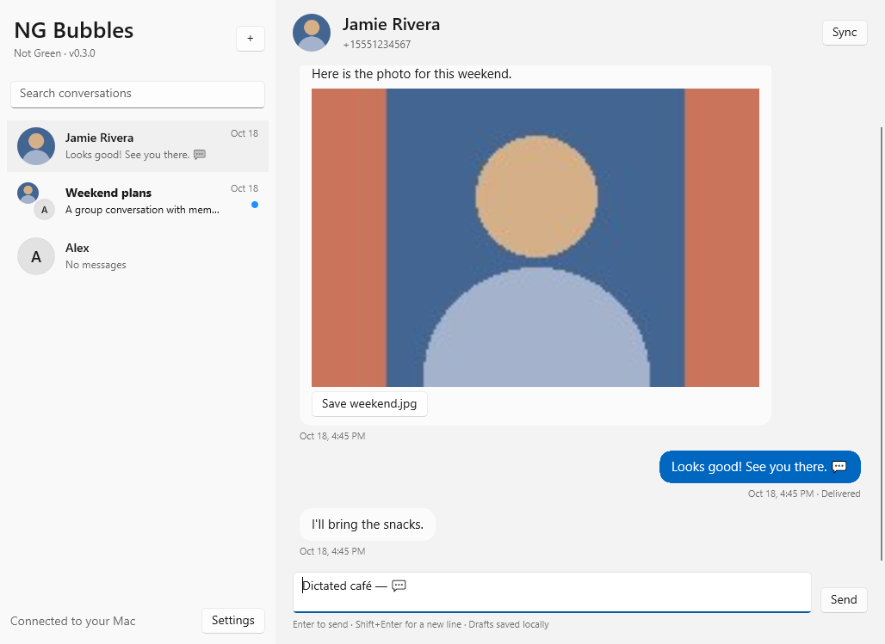

# NG Bubbles

**NG means “Not Green.”** An independent native Windows messaging client for the
[BlueBubbles server](https://github.com/BlueBubblesApp/bluebubbles-server).
Bring your own Mac and server. Not affiliated with or endorsed by BlueBubbles or Apple.

[Download NG Bubbles for Windows](https://github.com/jonworek/ng-bubbles/releases/latest).

Version **0.4.22** replaces the Electron application with **C# / .NET 10 and WinUI 3**.
The Windows interface uses native controls. No browser engine or Node.js runtime is
shipped in the native application.



## Features

- Individual and group conversations, recipient entry, conversation search, and automatic infinite scrolling through older history.
- One conversation per recipient across SMS/iMessage fallback, with combined cached history, read state, drafts, and notification activation. SMS/MMS/RCS bubbles are green; iMessage bubbles are blue. Groups and different recipient addresses stay separate.
- Distinct light/dark conversation headers and compact bubbles sized to their message text.
- Native Windows text entry with selection, clipboard, spelling, keyboard and accessibility support.
- REST recovery and a reconnecting Socket.IO-compatible live connection.
- Server-authoritative unread status and automatic read synchronization when Private API is available.
- Contact photographs, server group icons, and member portrait/initial circles as group fallback.
- Icon-only downloads belong to each attachment tile. Multiple photos use a two-column grid of separate 146 × 146 squares. Rich links show one clickable card with server-supplied title and preview art, rather than raw iMessage plugin files.
- Fixed 300 × 220 inline image/video previews reserve space before downloading, preventing attachment layout shifts. Images fit without cropping; click to open a larger resizable, zoomable window. Audio reserves a compact 300 × 80 frame. Save original attachments separately.
- Windows notifications with contact/group photos or member collages that activate and reveal the matching conversation.
- Close to tray, unread red dot, optional startup with Windows, and a stable tray GUID.
- Persistent history-page caching, offline access to previously loaded pages, saved drafts, and technical diagnostics accessible in Settings or Ctrl+Shift+D.
- Passwords protected with Windows DPAPI. No analytics, cloud account or third-party relay.

## Install or update

Windows 10 version 2004 or later, or Windows 11, x64.

1. Quit the old app from its tray menu so both clients do not run simultaneously.
2. Run `NG-Bubbles-0.4.22-x64-Setup.exe` from the release. The installer contains .NET
   and WinUI runtime files. Builds are unsigned.
3. Existing connection settings, cached conversations, unread state, and photos are
   imported from `%APPDATA%\BlueBubbles Desktop` into `%APPDATA%\NG Bubbles` on first
   launch. The original data is left intact. Re-enter the server password if Windows
   cannot unlock the old credential.
4. Old **browser drafts cannot be imported automatically**. Finish or copy them from
   the old app before uninstalling it. New drafts are saved by the native client.
5. Ctrl+Enter sends a message; Enter inserts a new line. Closing the window keeps the
   client in the tray. Ctrl+Q or the tray menu's Quit exits completely.

A portable folder is also distributed as `NG-Bubbles-0.4.22-x64-Portable.zip`. Extract
**all** files into a permanent folder and run `NG Bubbles.exe`; the executable needs
its adjacent native runtime files. Prefer the installer for Windows registration.

Renaming the application and replacing Electron can require pinning its tray icon
once again. Future native updates retain the same installer ID, install location,
executable name, and tray GUID. Windows ultimately controls tray visibility.

## Refreshing contacts

The Sync button fetches current contact names and photographs from your BlueBubbles server.
If a newly added Google contact is missing in both clients, check the server first:

- For the server's direct Google import, open Contacts → Continue with Google on the Mac and import again. BlueBubbles 1.9.9 does not keep an OAuth refresh token for continuous Google synchronization.
- For Google through macOS Contacts, confirm the contact appears in the Mac's Contacts app. Then use BlueBubbles Server → Contacts → Manage → Refresh Contacts. Restart the server if its native address-book cache remains stale.
- Click Sync in NG Bubbles after the server shows the contact. Previously cached history and drafts are retained.

For Google contacts already present in macOS but absent from BlueBubbles, an optional [daily Mac import helper](tools/macos-contact-sync/README.md) imports new names and addresses without restarting the server.

## Limits and diagnostics

Attachment uploads, reactions, calls and group administration are not implemented.
Preview downloads are limited to 16 MB each, three concurrent transfers, and a
100 MB attachment cache. Original files can be saved without that preview size limit.
Windows codecs provide image and media decoding. TIFF is handled through Windows;
HEIC/HEIF may require the Windows HEIF/HEVC extensions. A failed preview still offers
Save attachment and records a technical diagnostic.

API operations and cache writes run outside the UI thread. Lists use native
virtualization and update existing rows rather than replacing the entire interface.
These design choices do not establish a performance guarantee; measure memory,
startup, scrolling and dictation on the target Windows computer.

Settings → Diagnostics reports bounded technical events and process memory without
passwords, message text, contact names, addresses or server URLs. Do not post real
message screenshots or your local data folders in public issues.

Live updates use Engine.IO v4 / Socket.IO text events, heartbeat replies and
reconnection, with REST recovery every 20 seconds. Failed or ambiguous outgoing
sends are **never automatically retried**. The draft stays available so you can
check delivery before resending. Failed server read synchronization retries later.

## Development

The native source is in `native/`:

- `NgBubbles.Core`: protocol, reconnection, state, contacts, read synchronization, persistence.
- `NgBubbles.Windows`: WinUI interface, Windows image decoding, notifications, tray, settings.
- `NgBubbles.Tests`: integration tests against the synthetic REST and actual Socket.IO fixture.

Install .NET 10 SDK and Node.js 24 (Node is used by the tests, not the app).

```sh
npm ci --ignore-scripts
dotnet test native/NgBubbles.Tests
```

Build the native app **on Windows**, with Windows SDK / WinUI build tools:

```powershell
dotnet publish native/NgBubbles.Windows -c Release -p:Platform=x64 -o dist/native
./scripts/collect-native-licenses.ps1 -OutputDirectory dist/native
& 'C:/Program Files (x86)/Inno Setup 6/ISCC.exe' installer/ng-bubbles.iss
```

The Native Windows workflow compiles the client, runs protocol integration tests,
launches the real WinUI window with isolated synthetic data, packages an installer
and portable ZIP, and collects dependency notices. It does not prove Wispr Flow,
notification delivery, or pin retention on every Windows machine.

The original Electron implementation remains in `src/` and its tests for reference
and rollback. `npm start` runs that legacy client; it is not the native release.
Older release artifacts remain available in GitHub Releases.

## License and contributions

Application source and original icons are [MIT licensed](LICENSE). Forks and PRs are
welcome: [CONTRIBUTING.md](CONTRIBUTING.md).

The native distribution's runtime notices are in [NATIVE_NOTICES.md](NATIVE_NOTICES.md)
and its bundled `licenses/` folder. The historical Electron decoder notices remain
in [THIRD_PARTY_NOTICES.md](THIRD_PARTY_NOTICES.md) for the legacy source/releases.
See [provenance review](docs/PROVENANCE.md). No upstream BlueBubbles client/server
implementation or branding assets are bundled. API names identify interoperability.

### Startup troubleshooting

If startup fails, NG Bubbles displays an error and saves a technical report at
`%APPDATA%\NG Bubbles\last-error.txt`. The report includes exception types,
error codes and method names, without exception messages or message contents.
It can be shared in a GitHub issue. Saved settings and history are retained.

Windows acceptance checks launch the installed application through normal
first-run setup and legacy settings import, in addition to the messaging checks.

### Window size and updates

The default window is 1400 × 900 logical pixels, fitted to the current monitor.
Resizing automatically saves the normal dimensions and maximized state in
`%APPDATA%\NG Bubbles\window.json`, outside the installation folder. Updates
retain this file. Window dimensions account for Windows display scaling.

The app checks the latest stable GitHub release on startup and every six hours.
Choose **Download and install** in the update banner, or **Settings → Check for
updates**. The installer is downloaded only after confirmation, checked against
the release's SHA-256 digest, and installed silently after saving drafts and window settings. NG Bubbles exits
before files are replaced and reopens after installation. Your installation folder
and desktop shortcut choice are retained. Normal installer runs remember the
"Open NG Bubbles" choice, too. Update failures are recorded beside the downloaded
installer in `%APPDATA%\NG Bubbles\updates` as an `.exe.log` file. Update checks send no server credentials or
message data.


### Local connection and server recovery

In **Settings → Connection**, enter the complete local Mac URL including its port,
for example `http://your-mac.local:1234`. Local is preferred, with health checks
on the 20-second sync cycle so the app automatically returns from remote to local.
The remote URL is a fallback and becomes editable when local is unavailable.

When local is authenticated, NG Bubbles reads the server's existing Firebase
client configuration and its Firestore discovery document, verifies that the
advertised HTTPS address identifies the same Mac, and saves the updated fallback.
No server password is sent to Firebase, and no new service is installed on the Mac.
The remote field is disabled while local is available. If discovery is unavailable,
the last saved fallback is kept and Settings explains that it could not refresh it.
Saved Mac identity is checked when manually changing addresses, too.

Connection warnings appear above the connection status and Settings button in
the conversation list. Sidebar **Retry** and **Restart server** buttons appear only
while disconnected; both actions are always available in Settings. Recovery progress
clears once the new connection succeeds. **Restart server** asks for confirmation, then calls the
existing authenticated BlueBubbles `GET /api/v1/server/restart/hard` endpoint and
reconnects. It probes the configured addresses first, so it can use the local API
when the public tunnel is broken. It restarts BlueBubbles, not macOS. The Mac must
be awake and reachable through your home network or VPN, and BlueBubbles' HTTP
API must still respond. A stopped or completely hung server needs SSH or remote
access instead. The app never automatically restarts the server.

Messages and restart commands are never automatically resent after an uncertain
response. Drafts, cached history, and the selected conversation survive Retry.
Local HTTP is for a trusted home network or VPN; HTTPS certificate validation
remains enabled. Diagnostics identify local/remote failures and error categories
without recording addresses, credentials, or message contents.

### Home dashboard

Home replaces the empty conversation pane with unread, conversation, and saved-draft
counts, plus shortcuts to the latest unread chats, saved drafts, and recent
conversations. Click a card to open the conversation, or choose New message.
The Home icon beside the plus button returns to the dashboard and keeps your
current draft. Viewing Home does not mark any conversation read. Counts reflect
logical conversations, including combined SMS/iMessage threads. Offline Home
uses cached conversations and drafts; it does not fetch or summarize content
through an external service. The composer appears only inside a conversation.

### Settings tabs and shortcuts

Settings separates Connection, Preferences, Shortcuts, and Support into fixed
tabs. Connection contains the server, local address, password, and sending method.
Preferences contains notifications and Windows startup. Shortcuts lists the keys
without showing automatic floating hints. Support contains updates, diagnostics,
and server recovery. Unsaved edits stay in place when switching tabs; Save and
connect applies them, and Close discards them. Ctrl+Shift+D still opens diagnostics.

Settings keeps the same dialog size and button positions across all tabs. Its width
is capped to fit the app window, and longer tab content scrolls inside the dialog.

The tray icon shows the current unread count on hover, including after Windows
Explorer restarts. Conversations synchronize automatically through live updates
and a 20-second catch-up check. For an immediate manual refresh, use
**Settings → Support → Refresh conversations and photos** or the tray menu.

Use the filter button beside conversation search to show **Unread only**,
**Groups only**, or both together. Filters combine with names and addresses in
search and update as read status changes. The button shows the number of active
filters. **Clear filters** restores all conversations without clearing your search.
Your open conversation and draft remain available even when filtered out; opening
a notification or Home card clears filters and search to reveal that conversation.

Right-click the tray icon and choose **Check for updates** to bring NG Bubbles
forward and check the latest release using the same in-app update flow.

Links in messages are clickable and open using the app registered with Windows
for their URI scheme, including web, `mailto`, `tel`, and custom app links. Plain
email addresses become `mailto` links, and `www` addresses use HTTPS. Message text remains selectable. Reactions appear
as compact badges at the top left of the original message, including custom emoji,
changes, and removals. Hover a badge to see who reacted. Text-only summaries are
matched conservatively; ambiguous or not-yet-loaded targets remain readable in the
thread until they can be resolved. Raw reaction events remain in the local cache.

Server restarts can take over a minute, and temporary Cloudflare tunnel addresses
can change when BlueBubbles relaunches. Configure the local Mac address for reliable
recovery on your home network or VPN. Recovery shows elapsed time and releases the
controls after three minutes; automatic background reconnect continues.

Server reaction metadata is accepted as names, integer values, or numeric strings.
A conversation format error preserves cached data and reports a sync error without
claiming the reachable server is offline; diagnostics identify the affected field
without including message contents.

### Delete conversations

Right-click a conversation and choose **Delete conversation…**. For several,
choose **Select conversations…** from the filter menu or a conversation's
right-click menu, check the rows, and choose **Delete selected**. Cancel restores
normal navigation without changing messages or drafts.

Deletion requires BlueBubbles Server's Private API. The confirmation lists the
selected conversations and defaults to Cancel. Confirming deletes the underlying
Messages threads on the Mac, including merged SMS/iMessage sources; deletion may
sync through Messages in iCloud and does not unsend messages to recipients.
Confirmed deletions clear local cached history, unread indicators, and drafts.
Failed or ambiguous requests are not replayed and remain visible for review.
